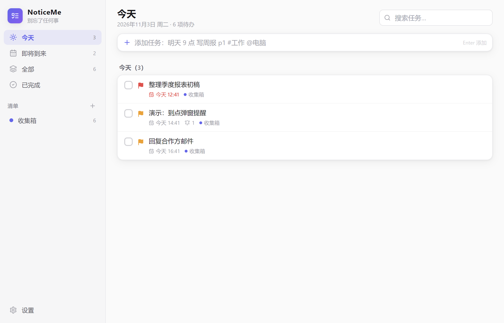
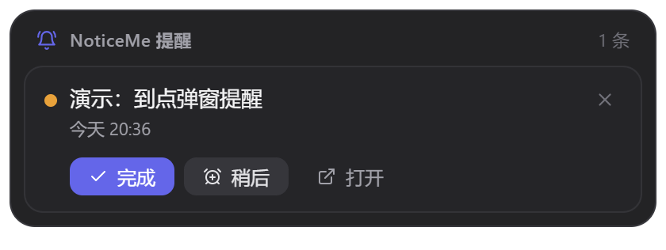
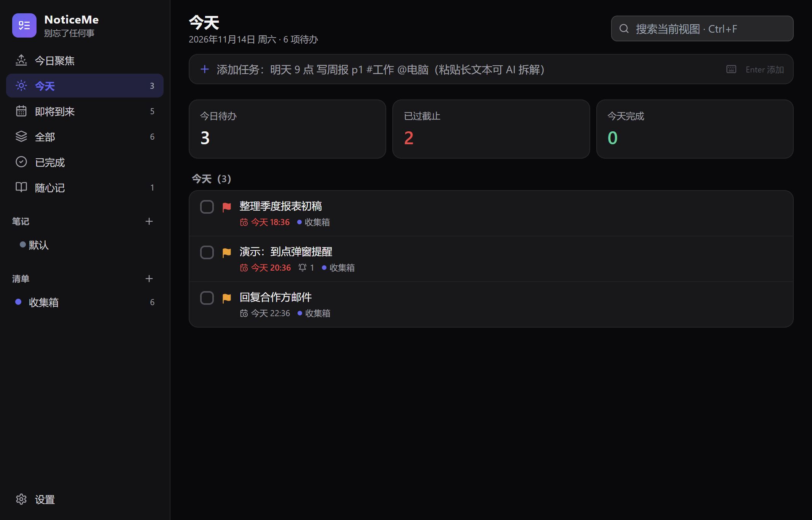

# NoticeMe

> 别忘了任何事 —— 本地优先的 Windows / macOS 桌面待办 + 提醒应用。数据不出你的电脑。





## 它解决什么问题

每天待办很多、容易忘、电脑用得多——NoticeMe 常驻托盘，到点用**置顶弹窗卡片 + 提示音 + Windows 系统通知**三层提醒你，错过启动后 30 分钟内还会自动补弹。想随手记点想法、日记或规划？切到「日记」板块，自由书写、自动按月归档。

## 功能

- **任务管理**：优先级 P1-P4、清单（项目）、标签、备注、截止时间
- **日记 / 随笔**：自由记录想法、日常与规划——心情标记、置顶、标签、按月归档、全文搜索、自动保存
- **及时提醒**：准时 / 提前 5 分钟~1 天多级提醒；贪睡（5/10/30/60 分钟/明天）；可选「未处理循环提醒」
- **重复任务**：每天 / 每个工作日 / 每周 / 每月 / 每年（月末自动钳制，逾期实例自动跳过不堆积）
- **自然语言快速添加**（输入框右侧 ⌨ 图标可查看完整语法速查）：`明天 9 点 写周报 p1 #工作 @电脑`、`9号早上9点 交房租`、`周末 体检`、`月底 盘点 紧急`、`明晚8点 追剧`、`下个月15号 发工资`、`2小时后 开会`、`礼拜五 交报告`、`3天内 交付初稿`、`明天下午 回复邮件`
- **本地 AI 增强（可选，默认关闭）**：在本机内嵌 Qwen2.5-1.5B 小模型（约 1 GB，数据与模型都不出你的电脑）——快速添加语法外的自由表达 AI 兜底解析（`周五之前交报告`、`下班后取快递`）；粘贴一段话自动拆成多条任务；从日记提取待办；一键生成本周回顾。AI 只提议、经预览确认后才入库，完全不触碰提醒链路
- **视图**：今天（逾期红色置顶）/ 即将到来 / 全部 / 已完成 / 按清单 + 搜索
- **常驻能力**：托盘（今日计数）、全局快捷键（`Ctrl+Alt+N` 快速添加、`Ctrl+Alt+S` 显隐）、开机自启、关闭即最小化
- **界面**：Todoist/TickTick 式干净布局，浅色 / 深色 / 跟随系统
- **数据安全**：全本地 JSON、原子写入、每日滚动备份 7 份、一键导出/导入

## 快速开始

```bash
npm install
npm run dev      # 直接体验
npm run dist     # 打包安装版/便携版（Windows，可选）
npm run dist:mac # 打包 dmg（需在 macOS 上执行，或走 GitHub Actions 的 mac-build 流水线）
```

详细命令、数据目录、故障排查见 [docs/RUNBOOK.md](docs/RUNBOOK.md)。

## 技术栈

Electron 33 · TypeScript 5 · React 18 · zustand · Tailwind CSS · electron-vite · vitest

架构与提醒触发链路见 [docs/TECH_DESIGN.md](docs/TECH_DESIGN.md)。

## 项目结构

```
src/shared/   纯逻辑（解析器/重复规则/调度核心/AI 提示词与校验）— 88 个单元测试覆盖
src/main/     主进程（存储/调度/托盘/通知/快捷键/提醒卡片窗口 + ai/ 本地模型 worker）
src/renderer/ 主界面 + 独立提醒卡片页
docs/         PRD / 技术设计 / AI 设计 / 运行手册 / 测试报告 / 角色流水线 Prompt
```

## 本地 AI 增强

设置 → 本地 AI（实验性）→ 开启后按需下载 Qwen2.5-1.5B 模型（约 1 GB，走 hf-mirror，支持断点续传），也可手动指定本机已有的 GGUF 文件。模型空闲自动卸载（默认 3 分钟），推理在独立进程进行，不影响提醒调度。详见 [docs/TECH_DESIGN-AI.md](docs/TECH_DESIGN-AI.md)。

## 路线图（V2 候选）

ICS 日历导入导出（可进 Windows/Outlook 日历）· 子任务 · 统计报表 · 番茄钟 · 多设备同步

## License

MIT
